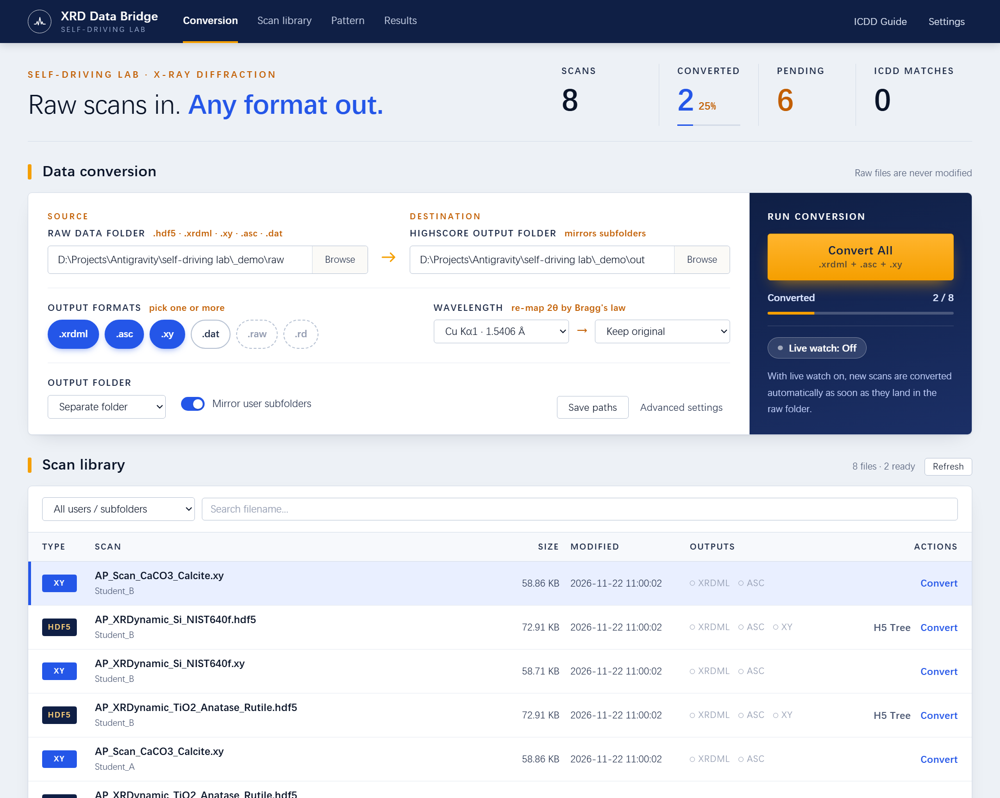
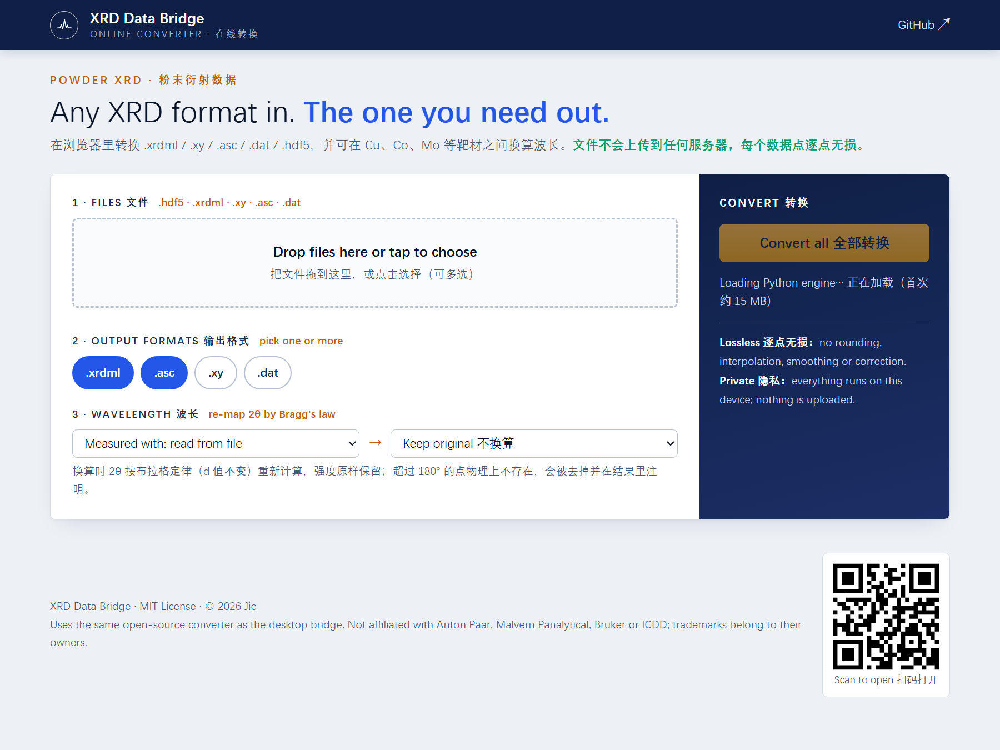

# XRD Data Bridge

**Lossless powder-XRD format converter for self-driving labs.**
粉末 XRD 数据格式转换工具：逐点无损，原始数据永不修改。

[**Online converter / 在线转换 →**](https://jliu-science.github.io/XRD-data-bridge/) &nbsp;·&nbsp; [Download for Windows / 下载 Windows 版](https://github.com/jliu-science/XRD-data-bridge/releases/latest)

| Desktop bridge (lab PC) | Online converter (any device, scan the QR code) |
| --- | --- |
|  |  |

---

## What it does / 功能

- **Reads** 读取: `.hdf5` / `.h5` (e.g. Anton Paar XRDynamic), `.xrdml`, `.xy` / `.xye`, `.asc` (PANalytical 2-column and Rigaku), `.dat`
- **Writes** 输出: `.xrdml`, `.asc`, `.xy`, `.dat` — choose any combination 任意组合
- **Wavelength re-mapping** 波长换算: Cu ↔ Co ↔ Mo ↔ Cr ↔ Fe ↔ Ag via Bragg's law (d-spacing preserved, intensities unchanged)
- **Folder watching** 文件夹监控 (desktop): new scans are converted automatically, user sub-folders are mirrored
- **Quality check and preview** 质量检查与预览, optional hand-off to HighScore Plus / ICDD Search & Match

Coming next: Bruker `.raw` and PANalytical `.rd` (see [notes](xrd_sdl_bridge/docs/BINARY_FORMATS_NOTES.md)).

## Data integrity / 数据完整性

- **Every data point is preserved exactly** 每个数据点逐点保留: no rounding, truncation, interpolation, resampling, smoothing or correction. Numbers are written in the shortest form that reads back to the identical value.
- **Raw files are never modified or overwritten** 原始文件绝不修改或覆盖. Files the bridge writes carry a marker so they are never mistaken for raw data.
- Wavelength re-mapping moves 2θ by design (physics, not error); points beyond 180° cannot exist and are dropped and reported.
- Verified by automated tests: exact round-trips through every format, SHA-256 checks of the raw folder in every mode. 由自动化测试验证。

## Online converter (students, phones) / 在线转换（学生、手机）

Open **https://jliu-science.github.io/XRD-data-bridge/** or scan the QR code shown at the bottom of that page.
The page runs the same converter in the browser (via [Pyodide](https://pyodide.org)); **files never leave your device**. The first visit downloads about 15 MB.

打开上面的网址或扫页面底部的二维码即可使用。转换在浏览器里完成，文件不会上传。

## Desktop bridge (lab PC, Windows) / 桌面版（实验室电脑）

1. Download `XRD-data-bridge-<version>-win64.zip` from [Releases](https://github.com/jliu-science/XRD-data-bridge/releases) — it includes a portable Python, nothing to install. 下载压缩包，自带 Python，无需安装。
2. Unzip the **whole folder** anywhere (local disk or network share). 解压整个文件夹。
3. Double-click `start_xrd_bridge.bat`; the page opens at `http://127.0.0.1:8765`. 双击启动。
4. Pick the raw data folder and output folder, choose output formats, press **Convert All** or turn on **Live watch**.

Updating: replace the folder but keep your `xrd_sdl_bridge/config.json` (your settings).
更新时替换文件夹，但保留 `config.json`（你的设置）。

### Running from source / 从源码运行

```bash
pip install -r requirements.txt
python xrd_sdl_bridge/app.py --open-browser
```

### Security / 安全

The desktop bridge is a **local-only** service: it serves only `localhost`, every API call needs a random per-launch token embedded in its own page, cross-site requests are rejected, file access is confined to the configured folders, and only HighScore / Data Viewer can be launched. Do not expose it to a network.
桌面版只供本机使用，请勿开放到网络。

## Development / 开发

```bash
cd xrd_sdl_bridge
python -m unittest discover -s tests -v     # security, data-integrity, formats, pipeline
python ../tools/build_web.py --serve         # online converter at http://127.0.0.1:8800
python ../tools/make_release.py 1.0.0        # Windows zip (needs ./python portable runtime)
```

## License / 许可

[MIT](LICENSE) © 2026 Jie.
Bundled third-party components keep their own licenses (Python: PSF; NumPy and h5py: BSD-3-Clause); their license files are included in the release zip.

Anton Paar, XRDynamic, Malvern Panalytical, HighScore, Bruker and ICDD are trademarks of their respective owners. This project is independent and not affiliated with or endorsed by them.
